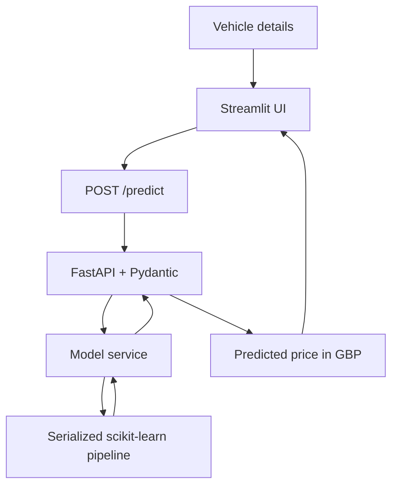

# Ford Car Price Predictor

A machine-learning project for estimating used Ford vehicle prices from listing features. It combines an exploratory data analysis and regression workflow with a FastAPI prediction API and a Streamlit interface. The repository also contains an experimental engineering iteration; its changes improve input handling and API diagnostics, but its reported MAPE is slightly higher than the original notebook result, so it is documented separately rather than presented as a model-accuracy improvement.

> **Project focus:** Regression modelling, exploratory data analysis, preprocessing pipelines, model comparison, cross-validation, hyperparameter tuning, regression metrics, model serialization, REST API development, request validation, and a lightweight ML user interface.

## Results at a glance

The original notebook compared five regressors and selected `HistGradientBoostingRegressor` for hyperparameter tuning. On the reported 20% holdout test split, the tuned model achieved **6.95% MAPE**, **£1,133.00 RMSE**, **£809.98 MAE**, and **0.9442 R²**.

| Original notebook benchmark | Value |
|---|---:|
| Test RMSE | 1,133.002 |
| Test MAE | 809.979 |
| Test R² | 0.9442 |
| Test MAPE | 6.95% |
| Train/test split | 80% / 20% |
| Split random state | 42 |
| Cross-validation | 5-fold shuffled `KFold` |

RMSE and MAE are reported in the dataset's price units; the application presents the target as GBP. These are the metrics provided from the original notebook run. They are not a guarantee of performance on future listings or a claim that API predictions have been independently benchmarked end to end.

### Original baseline vs. tuned model

| Metric | Linear Regression baseline — test | Tuned HistGradientBoosting — test | Change |
|---|---:|---:|---:|
| RMSE | 1,808.697 | 1,133.002 | 37.36% lower |
| MAE | 1,351.265 | 809.979 | 40.06% lower |
| R² | 0.858 | 0.9442 | +0.0862 |
| MAPE | Not provided | 6.95% | Not comparable |

### Reported training and test metrics

| Model | Split | RMSE | MAE | R² |
|---|---|---:|---:|---:|
| Linear Regression baseline | Train | 1,848.503 | 1,361.339 | 0.847 |
| Linear Regression baseline | Test | 1,808.697 | 1,351.265 | 0.858 |
| Tuned HistGradientBoosting | Train | 1,019.944 | 720.680 | 0.9533 |
| Tuned HistGradientBoosting | Test | 1,133.002 | 809.979 | 0.9442 |

## Original notebook cross-validation comparison

The original notebook compared Linear Regression, Ridge, Lasso, Random Forest, and HistGradientBoosting using five-fold cross-validation. The reported results were:

| Model | CV RMSE | CV MAE | CV R² |
|---|---:|---:|---:|
| HistGradientBoostingRegressor | 1,219.192 | 832.564 | 0.933 |
| RandomForestRegressor | 1,289.784 | 884.484 | 0.925 |
| Ridge | 1,859.542 | 1,366.170 | 0.845 |
| LinearRegression | 1,859.749 | 1,366.473 | 0.844 |
| Lasso | 1,860.458 | 1,366.629 | 0.844 |

The reported best parameters for the tuned HistGradientBoosting model were:

```python
{
    "model__l2_regularization": 0.1,
    "model__learning_rate": 0.1,
    "model__max_depth": None,
    "model__max_leaf_nodes": 63,
    "model__min_samples_leaf": 20,
}
```

The grid contained 243 parameter combinations. The notebook's reported final test MAPE was 6.95%.

## Experimental engineering iteration

The repository also contains a second set of files, uploaded with names similar to `ProjectImproved.ipynb`, `model_service_improved.py`, `schemas_improved.py`, `main_improved.py`, `app_improved.py`, and `test_prediction_improved.py`. Check the exact spelling and capitalization of the filenames in the repository and adjust the table below if they differ.

These files represent an **experimental engineering iteration**, not a validated improvement in predictive accuracy.

| Version | Reported MAPE | Interpretation |
|---|---:|---|
| Original notebook's tuned model | 6.95% | Current reference benchmark from the original run |
| Experimental iteration | 7.16% | 0.21 percentage points higher MAPE; not an accuracy improvement |

The experimental MAPE is approximately 3.02% higher relative to the original value. This comparison is meaningful only if both values were calculated on the same test rows using the same MAPE definition. The experiment's corresponding RMSE, MAE, R², selected parameters, and exact test-split details have not been supplied, so they are intentionally not inferred here.

### What the experimental files attempt to improve

- Normalize categorical feature values consistently before prediction.
- Make the serialized model path configurable with `FORD_MODEL_PATH`.
- Add explicit request constraints and categorical validation.
- Separate API liveness from model readiness.
- Avoid returning detailed internal exceptions to API clients.
- Improve Streamlit validation and error messages.
- Add API contract tests for request handling and response format.

These are useful engineering goals, but the experimental MAPE of 7.16% is worse than the original reported 6.95%. The experimental model should not be described as more accurate. Keep it clearly labelled as experimental until it is evaluated and the accuracy impact is understood.

**Recommended benchmark policy:** Use the original notebook's 6.95% result as the reference score. Preserve the experimental files for review if you want to show iterative engineering work, but do not describe them as an accuracy improvement. For a clean portfolio repository, put them in an `experiments/` folder or a separate branch, or remove them from the main branch if they are not intended to be supported. Do not silently mix the two versions in the same run instructions.

## Project architecture



## Dataset

The supplied `ford.csv` has **17,966 rows and 9 columns** before cleaning. Initial inspection found 154 duplicate rows, one row with year `2060`, and 51 rows where `engineSize` is zero. The original notebook removes duplicate rows and filters out years above 2026; zero engine sizes should be investigated against the dataset source before deciding whether they represent valid values or missing data.

### Features

| Feature | Description | Type |
|---|---|---|
| `model` | Ford vehicle model | Categorical |
| `year` | Vehicle year | Numeric |
| `transmission` | Transmission type | Categorical |
| `mileage` | Vehicle mileage | Numeric |
| `fuelType` | Fuel type | Categorical |
| `tax` | Vehicle tax | Numeric |
| `mpg` | Fuel economy in miles per gallon | Numeric |
| `engineSize` | Engine displacement | Numeric |
| `price` | Target vehicle price | Target |

The inspected dataset is imbalanced across some categories, including 22 hybrid examples, 2 electric examples, and 1 example labelled `Other`. Results for rare categories may be less reliable than results for well-represented categories.

**Dataset provenance:** The source URL and licence were not present in the files supplied for this README. Add the original source and licence details before publishing the dataset or redistributing it.

## Machine-learning workflow

1. **Load and inspect the data:** Read `ford.csv`, review dimensions, types, missing values, distributions, and duplicates.
2. **Clean the data:** Normalize categorical values, remove duplicates, and filter invalid future years according to the notebook's current rule.
3. **Explore features:** Use numerical summaries, category counts, histograms, boxplots, and numerical correlations.
4. **Split data:** Use an 80/20 train/test split with `random_state=42`.
5. **Build preprocessing:** Use median imputation and standard scaling for numerical features; most-frequent imputation and one-hot encoding for categorical features.
6. **Compare models:** Evaluate five regressors using five-fold cross-validation and RMSE, MAE, and R².
7. **Tune the candidate:** Use `GridSearchCV` to tune HistGradientBoosting based on negative RMSE.
8. **Evaluate:** Report training/test RMSE, MAE, R² and test MAPE; examine residuals and errors by vehicle segment as further validation.
9. **Serve predictions:** Load a serialized fitted pipeline in the FastAPI model service and call it from the Streamlit interface.

## Technologies

- **Python** — implementation language
- **pandas, NumPy** — data preparation and numerical operations
- **Matplotlib, Seaborn** — visual exploratory data analysis
- **scikit-learn** — preprocessing, regression, cross-validation, hyperparameter search, and metrics
- **joblib** — model serialization
- **FastAPI, Pydantic, Uvicorn** — prediction API and input validation
- **Streamlit, Requests** — user interface and HTTP client
- **pytest, httpx** — experimental API contract tests

The exact Python and dependency versions used for the original metrics have not been provided. Record them in `requirements.txt` and use a compatible scikit-learn version to load the saved artifact.

## Repository files

The original project files supplied for review were:

| File | Purpose |
|---|---|
| `Project.ipynb` (possibly uploaded as `Project(1).ipynb`) | Original EDA, model comparison, tuning, evaluation, and prediction helper |
| `model_service.py` (possibly `model_service(1).py`) | Loads the model artifact and builds the inference DataFrame |
| `schemas.py` (possibly `schemas(1).py`) | Pydantic request/response models |
| `main.py` (possibly `main(1).py`) | FastAPI endpoints |
| `app.py` (possibly `app(1).py`) | Streamlit form and prediction display |
| `ford.csv` | Dataset |
| `ford_price_model.pkl` | Expected serialized pipeline artifact |

The experimental files should be listed separately:

| File | Purpose |
|---|---|
| `ProjectImproved.ipynb` | Experimental notebook iteration; verify the exact filename in the repository |
| `model_service_improved.py` | Experimental model loading and inference service |
| `schemas_improved.py` | Experimental input and response validation |
| `main_improved.py` | Experimental FastAPI lifecycle, readiness, and error handling |
| `app_improved.py` | Experimental Streamlit form and error messages |
| `test_prediction_improved.py` | Contract tests for the experimental API modules |

If your uploaded notebook is actually named `Project_improved.ipynb`, update the README's filename to match. GitHub paths are case-sensitive in many deployment environments.

## Setup and running the original project

The original API uses relative imports, so place the backend files inside a Python package containing `__init__.py`, or adjust the imports to match your repository.

### 1. Create a virtual environment

```bash
python -m venv .venv
```

Activate it:

```bash
# macOS / Linux
source .venv/bin/activate

# Windows PowerShell
.venv\Scripts\Activate.ps1
```

### 2. Install dependencies

```bash
python -m pip install numpy pandas matplotlib seaborn scikit-learn joblib fastapi "uvicorn[standard]" pydantic streamlit requests jupyter
```

For reproducibility, pin the exact dependency versions from the environment used to train and evaluate the model.

### 3. Train and save the original model

Place `ford.csv` in the path expected by the notebook (`../data/ford.csv` relative to its working directory), open `Project.ipynb`, and execute the cells. The original notebook's `joblib.dump` line is commented out, so save the fitted `hgb_best` pipeline to the path expected by the model service before launching the API. Ensure the model artifact's scikit-learn version is compatible with the API environment.

### 4. Run the original FastAPI app

From the repository root, for a package named `backend`:

```bash
uvicorn backend.main:app --reload --host 127.0.0.1 --port 8001
```

The original API exposes:

| Method | Path | Purpose |
|---|---|---|
| GET | `/` | Basic status message |
| GET | `/health` | Basic health response |
| POST | `/predict` | Return a price estimate |

Interactive API documentation is available at `http://127.0.0.1:8001/docs` while the server is running.

### 5. Run the original Streamlit app

In a second terminal:

```bash
# Windows PowerShell
$env:API_URL = "http://127.0.0.1:8001"
streamlit run app.py
```

The UI's `API_URL` variable is a base URL; `app.py` appends `/predict` to it.

## Running the experimental variant

The experimental API modules use relative imports, so put them in a Python package with the other experimental files or adapt the package structure. Configure `FORD_MODEL_PATH` to point to the artifact created by the notebook you intend to serve. Train and evaluate the experimental notebook before serving its model; do not assume a previous artifact was retrained.

Example commands, if the experimental modules are in a `backend` package and their imports match that package:

```bash
uvicorn backend.main_improved:app --host 127.0.0.1 --port 8001
streamlit run app_improved.py
```

Install test tools if needed and run the contract tests from the directory containing the test module:

```bash
python -m pip install pytest httpx
python -m pytest test_prediction_improved.py -q
```

The contract tests use a fake model service and do not, by themselves, validate predictive accuracy or prove that the deployed model artifact loads correctly. Run an end-to-end test against the actual serialized artifact as well.

## Limitations and next steps

- **Inference normalization:** The original notebook lowercases categories, while the original model service only strips whitespace. Align preprocessing at inference with the training vocabulary and verify prediction consistency.
- **Notebook helper:** The original notebook's standalone `predict_ford_price` helper omits `year` from the input DataFrame and repeats the `fuelType` key. Correct it before relying on that helper.
- **Model artifact workflow:** The original notebook's export line is commented out. Automate saving the full fitted pipeline at the exact location expected by the API.
- **Supported inputs:** UI limits and backend schema constraints differ. Establish feature ranges from domain requirements and training data, and handle categories unseen during training transparently.
- **Independent validation:** Use an external or time-based holdout to assess generalization to later listings; the current random split may not represent future market conditions.
- **Error analysis:** Report error by model, year, price band, and fuel type. Investigate rare categories before making claims about their prediction quality.
- **Data provenance:** Document the dataset source and its licence.
- **Experiment tracking:** Record data filters, random seeds, package versions, parameter search space, selected parameters, and all test metrics for each run.
- **Deployment hardening:** Use separate liveness/readiness checks, structured logs, and generic client-facing errors before public deployment.

## Responsible use

This project provides an estimate from historical listing data, not a guaranteed market value or a professional valuation. Actual sale prices can depend on vehicle condition, trim, service history, accident history, location, and market changes that may not be represented by the input features.

## Author

**Muhammad Kamran**

Replace these placeholders and confirm the repository paths before publishing.
