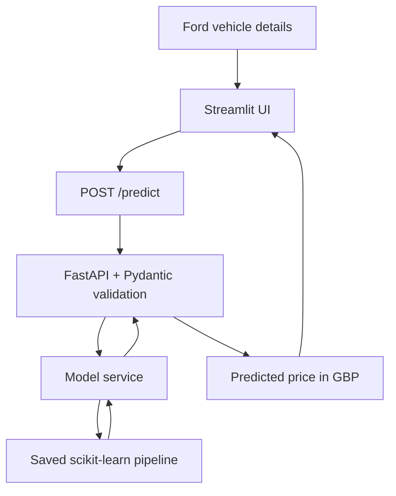

# Ford Car Price Predictor

A machine-learning project that estimates the market price of a used Ford vehicle from its model, year, transmission, mileage, fuel type, tax, fuel economy, and engine size. The project combines a scikit-learn regression workflow with a FastAPI prediction service and a Streamlit user interface.

> **Project focus:** Regression modelling, exploratory data analysis, feature preprocessing, cross-validation, hyperparameter tuning, model evaluation, model serialization, API development, and a simple ML application interface.

## Results at a glance

The original notebook compares a Linear Regression baseline with a tuned `HistGradientBoostingRegressor`. On the reported 20% holdout test set, the tuned model achieved an RMSE of **£1,133.00**, an MAE of **£809.98**, an R² of **0.9442**, and a reported MAPE of **6.95%**.

| Test-set metric | Linear Regression baseline | Tuned HistGradientBoosting | Change |
|---|---:|---:|---:|
| RMSE | £1,808.697 | £1,133.002 | 37.36% lower |
| MAE | £1,351.265 | £809.979 | 40.06% lower |
| R² | 0.858 | 0.9442 | +0.0862 |
| MAPE | Not recorded for the baseline | 6.95% | Not comparable |

RMSE and MAE are expressed in the dataset's price units, presented as GBP by the application. The RMSE/MAE change compares the reported baseline and tuned-model results from the same original project. MAPE was reported for the tuned model only, so no MAPE improvement is claimed.

### Reported training and test metrics

| Model | Split | RMSE | MAE | R² |
|---|---|---:|---:|---:|
| Linear Regression baseline | Train | 1,848.503 | 1,361.339 | 0.847 |
| Linear Regression baseline | Test | 1,808.697 | 1,351.265 | 0.858 |
| Tuned HistGradientBoosting | Train | 1,019.944 | 720.680 | 0.9533 |
| Tuned HistGradientBoosting | Test | 1,133.002 | 809.979 | 0.9442 |

The tuned model's training error is lower than its test error, as expected. The holdout test results are the more relevant estimate of performance on unseen examples. These are the original reported results; retraining with different data, preprocessing, package versions, or splits may produce different metrics.

## Project overview

The application accepts eight vehicle features and returns a predicted price in GBP.



### Main components

| Component | Responsibility |
|---|---|
| `Project.ipynb` | Loads the CSV, performs EDA and cleaning, builds preprocessing pipelines, compares models, tunes the candidate model, evaluates predictions, and provides an inference example. |
| `model_service.py` | Loads the saved joblib artifact and constructs a DataFrame for inference. |
| `schemas.py` | Defines Pydantic request validation and the prediction response schema. |
| `main.py` | Exposes the FastAPI root, health, and prediction endpoints. |
| `app.py` | Provides the Streamlit form and displays the estimated price returned by the API. |
| `ford.csv` | Dataset used for model development. |
| `ford_price_model.pkl` | Serialized fitted scikit-learn pipeline expected by the API service. |

## Dataset

The notebook reads `../data/ford.csv` and uses `price` as the target. The supplied CSV was inspected as a dataset of **17,966 rows and 9 columns**. The initial inspection found **154 duplicate rows**, a record with year **2060**, and **51 rows with an engine size of zero**. The notebook removes duplicate rows and filters out years greater than 2026; the meaning of zero engine-size values should be verified before deciding whether to retain or impute them.

### Input features

| Feature | Description | Type |
|---|---|---|
| `model` | Ford vehicle model | Categorical |
| `year` | Vehicle year | Numeric |
| `transmission` | Transmission type | Categorical |
| `mileage` | Mileage | Numeric |
| `fuelType` | Fuel type | Categorical |
| `tax` | Vehicle tax | Numeric |
| `mpg` | Fuel economy in miles per gallon | Numeric |
| `engineSize` | Engine displacement | Numeric |
| `price` | Vehicle price to predict | Target |

The notebook normalizes the three categorical columns by trimming whitespace and converting values to lowercase. The dataset is imbalanced across some fuel types: the inspected data included only 22 hybrid examples, 2 electric examples, and 1 example labelled `Other`. Predictions for these rare categories may be less reliable than predictions for well-represented categories.

**Data source:** The project uses a local `ford.csv` file. The source URL and dataset licence were not included in the supplied project files; add them here before publishing the dataset or redistribution instructions.

## Methodology

### 1. Exploratory data analysis

The notebook explores the dataset using:

- Dataset shape, column types, and missing-value counts.
- Duplicate detection and removal.
- Numerical summaries and categorical frequency counts.
- Histograms and boxplots for distributions and potential outliers.
- A numerical correlation heatmap and correlation with the target price.

### 2. Train/test split

The notebook uses an 80/20 train/test split with `random_state=42`. A five-fold `KFold` cross-validation strategy uses shuffling and the same random seed for model comparison.

### 3. Preprocessing

Preprocessing is implemented with scikit-learn pipelines and a `ColumnTransformer` so the transformations are fitted as part of model training.

- **Numerical features:** median imputation followed by `StandardScaler`.
- **Categorical features:** most-frequent imputation followed by `OneHotEncoder(handle_unknown="ignore", sparse_output=False)`.

The complete fitted preprocessing-plus-estimator pipeline should be serialized and loaded for inference, rather than saving only the estimator.

### 4. Baseline and model comparison

Linear Regression is the initial baseline. The notebook compares the following regressors with five-fold cross-validation, reporting mean RMSE, MAE, and R²:

- Linear Regression
- Ridge Regression
- Lasso Regression
- Random Forest Regressor
- HistGradientBoosting Regressor

### 5. Cross-validation results

The following scores were reported by the original notebook. Lower RMSE/MAE are better; higher R² is better.

| Model | CV RMSE | CV MAE | CV R² |
|---|---:|---:|---:|
| HistGradientBoostingRegressor | 1,219.192 | 832.564 | 0.933 |
| RandomForestRegressor | 1,289.784 | 884.484 | 0.925 |
| Ridge | 1,859.542 | 1,366.170 | 0.845 |
| LinearRegression | 1,859.749 | 1,366.473 | 0.844 |
| Lasso | 1,860.458 | 1,366.629 | 0.844 |

HistGradientBoosting had the lowest cross-validation RMSE among the five tested candidates and was selected for hyperparameter tuning.

### 6. Hyperparameter tuning

The original notebook uses `GridSearchCV` with five-fold cross-validation and negative RMSE as its scoring function. The parameter grid contains 243 combinations.

Reported best parameters:

```python
{
    "model__l2_regularization": 0.1,
    "model__learning_rate": 0.1,
    "model__max_depth": None,
    "model__max_leaf_nodes": 63,
    "model__min_samples_leaf": 20,
}
```

### 7. Evaluation

The notebook evaluates the fitted tuned model using RMSE, MAE, and R² on both the training and test partitions. It also calculates percentage errors and reports a MAPE of 6.95% for the tuned model. The model's prediction errors should be evaluated by vehicle model, year, and price range as a next step, particularly given the low counts for some categories.

## Technology stack

- **Python** — project language
- **pandas, NumPy** — data loading and numerical work
- **Matplotlib, Seaborn** — exploratory data visualisation
- **scikit-learn** — preprocessing, regression, cross-validation, tuning, and evaluation
- **joblib** — serializing and loading the fitted pipeline
- **FastAPI** — prediction API
- **Pydantic** — request and response validation
- **Uvicorn** — ASGI server for FastAPI
- **Streamlit** — interactive user interface
- **Requests** — HTTP calls from Streamlit to the API

Exact Python and package versions were not included in the supplied source files. For reproducible loading of a scikit-learn joblib artifact, use the same compatible scikit-learn version as the training environment and record the versions in a `requirements.txt` file.

## Repository layout

The following is a suggested layout consistent with the paths and relative imports in the supplied source. Adjust directory names if your actual repository differs.

```text
ford-price-predictor/
├── app.py
├── data/
│   └── ford.csv
├── models/
│   └── ford_price_model.pkl
├── notebooks/
│   └── Project.ipynb
└── backend/
    ├── __init__.py
    ├── main.py
    ├── model_service.py
    └── schemas.py
```

## Getting started

### 1. Clone the repository

```bash
git clone <your-repository-url>
cd ford-price-predictor
```

### 2. Create an environment and install dependencies

```bash
python -m venv .venv
```

Activate the environment:

```bash
# macOS / Linux
source .venv/bin/activate

# Windows PowerShell
.venv\Scripts\Activate.ps1
```

Install the packages used by the project:

```bash
python -m pip install numpy pandas matplotlib seaborn scikit-learn joblib fastapi "uvicorn[standard]" pydantic streamlit requests jupyter
```

For repeatable deployment, pin the tested versions in `requirements.txt` after confirming the versions used to train the model.

### 3. Place the dataset and train the model

Place the dataset at `data/ford.csv`, open `notebooks/Project.ipynb`, and execute the notebook to reproduce the analysis and training process.

The API's model service expects the serialized pipeline at:

```text
models/ford_price_model.pkl
```

The original notebook's save statement is commented out, so ensure the fitted pipeline is explicitly saved to the path expected by the API before starting the backend. The training and serving environments must use compatible versions of scikit-learn and its dependencies.

### 4. Start the API

From the repository root, if the backend package is named `backend` and contains `__init__.py`, run:

```bash
uvicorn backend.main:app --reload --host 127.0.0.1 --port 8001
```

If your package has a different name or location, replace `backend.main:app` with the corresponding import path. FastAPI's interactive documentation is available at `http://127.0.0.1:8001/docs` while the server is running.

Available endpoints in the original API:

| Method | Endpoint | Purpose |
|---|---|---|
| `GET` | `/` | Basic API status message |
| `GET` | `/health` | Basic health response |
| `POST` | `/predict` | Predict a vehicle price |

Example prediction request:

```json
{
  "model": "Fiesta",
  "year": 2017,
  "transmission": "Manual",
  "mileage": 15000,
  "fuelType": "Diesel",
  "tax": 125,
  "mpg": 57.7,
  "engineSize": 1.5
}
```

Example response shape:

```json
{
  "predicted_price": 8500.0,
  "currency": "GBP"
}
```

The response number above is illustrative only, not a recorded prediction for the example request.

### 5. Start the Streamlit interface

In a second terminal, with the environment activated, run:

```bash
streamlit run app.py
```

The UI defaults to `http://127.0.0.1:8001` for the API. To override the base URL, set the `API_URL` environment variable before launching Streamlit.

PowerShell example:

```powershell
$env:API_URL = "http://127.0.0.1:8001"
streamlit run app.py
```

## API contract

### Request fields

The `/predict` endpoint expects all eight input features: `model`, `year`, `transmission`, `mileage`, `fuelType`, `tax`, `mpg`, and `engineSize`. The request schema applies basic type and numeric-bound checks. Refer to `schemas.py` for the exact limits used by the checked-out version of the project.

### Response fields

- `predicted_price`: numeric estimated price rounded to two decimal places by the API.
- `currency`: `GBP`.

## Engineering considerations and future work

The current project is a useful end-to-end ML prototype. The following are meaningful next steps before relying on it for real-world pricing:

1. **Align training and inference preprocessing.** The notebook lowercases category values, while the original model service only strips whitespace. Apply the same canonical normalization before inference to avoid category mismatches with the fitted one-hot encoder.
2. **Make model artifact generation reproducible.** The original notebook's export statement is commented out, while the API expects a particular path. Automate artifact saving and verify that the saved pipeline reloads successfully.
3. **Correct and test the notebook inference helper.** The original standalone prediction helper omits the `year` column from its DataFrame and defines `fuelType` twice. Keep the inference feature set exactly aligned with the eight training features.
4. **Unify input constraints.** The Streamlit controls and Pydantic request schema have different numeric boundaries, and the schema accepts arbitrary non-empty categorical strings. Define supported categories and documented ranges based on the training dataset.
5. **Add automated integration tests.** Test request validation, category normalization, model loading, response shape, and a real prediction with the saved artifact.
6. **Evaluate reliability across subgroups.** Inspect MAE and RMSE by car model, year, price bands, and fuel type; categories with very few examples need particular care.
7. **Use robust validation for future data.** A random split estimates performance on a similar distribution. Consider a time-based holdout or external validation set if the intended use is estimating prices for newer listings.
8. **Improve operational observability.** Separate process liveness from model readiness, keep client-facing errors generic, and log enough diagnostic information for debugging without exposing internal details.
9. **Track experiments and artifacts.** Record package versions, data-cleaning rules, random seeds, parameters, metrics, and artifact versions with each model run.
10. **Document data provenance.** Add the dataset source, licence, and any redistribution requirements before sharing the dataset publicly.

These are identified engineering opportunities; they should not be interpreted as features already implemented in the original files.

## Responsible use

This model provides an estimate based on historical listings in the training dataset. It is not a professional valuation, dealership quote, or guarantee of a sale price. Prices may vary with vehicle condition, trim, location, service history, accident history, and market changes—factors not all represented in the listed input features.

## Author

**Muhammad Kamran**
